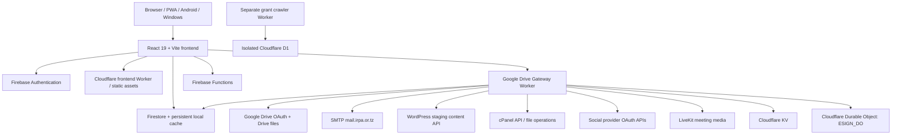
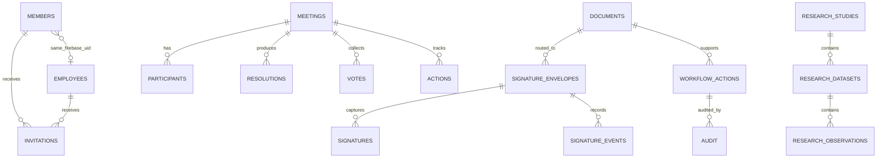

# Software Requirements Specification (SRS)
## IRPA Digital Board Governance System (IRPA-DBGS)
**Document status:** Reverse-engineered baseline / review draft  
**Standard structure:** IEEE 29148-aligned (requirements engineering)  
**Repository baseline:** `main` at `f20403e6f26c296f9d3aa3cda87588115a0f694d`  
**Inspection date:** 30 October 2026  
**Scope:** Documentation only; no application, rules, production or deployment changes.

> **Evidence convention:** IMPLEMENTED = directly evidenced in inspected source; GAP = requested or expected but not found/verifiable; PROPOSED = recommended future requirement. This SRS does not claim that every source-implemented function is enabled or healthy in production.

## 1. Introduction

### 1.1 Purpose
This SRS records the observable and source-level requirements of IRPA-DBGS so IRPA can review scope, roles, workflows, data, interfaces, quality attributes and release controls against the implementation. It is a reverse-engineered baseline, not a statement that all functions are production-ready.

### 1.2 Scope
IRPA-DBGS is a browser-first institutional governance workspace for IRPA board members, personnel, administrators, auditors and authorised operational users. The inspected source covers identity and invitations; governance and meetings; controlled documents and e-signature; authorisation/approval; finance and procurement; risk, reports and audit; research/data; grant intelligence; communications/media; IT/system administration; and installable/offline client packaging.

The source includes multiple execution boundaries: React/Vite frontend; Firebase Authentication and Firestore; Firebase Functions; Cloudflare frontend Worker and Google Drive Gateway; Google Drive; SMTP; WordPress/cPanel website integration; social-provider OAuth; LiveKit meeting media; a separate grant-crawler Worker and D1 database; PWA, Electron and Capacitor Android packaging.

Out of scope: redesigning the business rules; asserting legal validity of electronic signatures; inferring donor/grant submission capability; asserting operational WordPress/cPanel credentials; changing data retention policy; and making production changes.

### 1.3 Stakeholders
- IRPA Board and Board Chairperson: governance, meetings, resolutions, voting and oversight.
- Executive Director and authorised approvers: institutional decisions, approvals and execution.
- Secretariat / administrator: identity lifecycle, invitations, meeting coordination and records.
- Department directors and personnel: departmental records, actions, reports and approvals.
- Finance and procurement personnel: financial controls, procurement and payment traceability.
- Communications personnel and approvers: editorial, website, social and media governance.
- Research/data personnel: collection, datasets, analysis, information exchange and release readiness.
- External auditors and special invitees: restricted read or meeting access.
- IT/system administrators: configuration, access and release diagnostics.
- Developers/maintainers: code, integrations, tests, deployment and recovery.

### 1.4 Definitions and abbreviations
- **DBGS:** Digital Board Governance System.
- **Worker/Gateway:** Cloudflare server-side API boundary; the Drive Gateway is named `irpa-google-drive-gateway`.
- **Actual / Trial:** data environments selected through the Data Environment Gate; identity/security collections are designated Actual-only in the data layer.
- **PWA:** Progressive Web App.
- **DO:** Cloudflare Durable Object; `ESIGN_DO` is bound for e-signature records.
- **KV:** Cloudflare Workers KV; production gateway binding is `DRIVE_KV`.
- **D1:** Cloudflare SQL database used by the isolated parallel grant crawler.
- **Lifecycle:** controlled document state transitions, signature and archive stages.
- **IMPLEMENTED / GAP / PROPOSED:** evidence labels defined above.

### 1.5 Evidence and limitations
The source inventory and route registrations were inspected on the repository's `main` baseline. The public live URL `https://irpa-digital-board-governance.web.app` was not accessible to the available unauthenticated inspection channel. No authenticated browser session or production diagnostic request was performed. Accordingly, runtime status, actual account-specific role assignment, provider credentials, live data, production WordPress/cPanel reachability and mobile rendering are **GAP / not runtime-verified**.

## 2. Overall description

### 2.1 Product perspective / architecture

**IMPLEMENTED architecture observations**
- Frontend uses React 19, Vite and Firebase JS SDK 11; app navigation and role projection are primarily in `src/App.jsx`.
- Firebase config initializes Auth and Firestore with persistent local cache and multi-tab manager. Applicant enrollment has a separate named Firebase app instance.
- The frontend Worker serves built assets from `dist`; Firebase Hosting rewrites SPA routes to `index.html`.
- Drive Gateway uses Cloudflare Worker entry `drive-gateway/src/index.js`, router modules and Firestore REST/admin token logic. It is configured with Google Drive, SMTP, KV and e-signature Durable Object bindings.
- A separate grant crawler exists; its parallel implementation stores discovered public-call metadata in isolated D1 and explicitly does not yet synchronize to production Firestore.
- Browser permission projection is not a security boundary; Firestore rules and trusted backend checks remain authoritative.

**GAP:** no single authoritative architecture diagram or complete runtime deployment inventory was found that proves all environments and bindings are currently active.

### 2.2 Product functions
The product functions are captured by the functional requirements in §3 and page inventory in §6. The current NAV constant declares **31 top-level modules**, not 26. The source separately declares **15 nested sub-portals**. The application also has standalone authentication, invitation activation, entry gateway, signature and modal states.

### 2.3 User classes and roles
Source-visible role families include Administrator; Executive Director; Board Chairperson, Vice Chairperson, Secretary, Treasurer and Board Member; department directors; Internal Oversight roles; HR Manager/Officer; Finance Manager/Officer/Accountant/Finance Personnel; Procurement Officer/Manager/Team Member; Programme/Technical Officer; Operations Manager; IT Specialist/Information Technology Officer; Communications Officer/Manager, Media Officer, Public Relations Officer and Approver; External Auditor; special invitees, observers and view-only recipients; and induction applicants.

Role membership and effective access are resolved from active member/employee/auditor/admin profiles and permission policy. Departmental module mapping is also present. The complete live roster and assignment matrix is data-dependent and cannot be enumerated from source alone.

### 2.4 Operating environment
- Web: modern browser with JavaScript, HTTPS, Firebase Auth and network access.
- Mobile: responsive web/PWA at 390 CSS px target width; manifest display mode standalone.
- Windows: Electron BrowserWindow; context isolation on, Node integration off, sandbox on; HTTPS URL with offline HTML fallback.
- Android: Capacitor; local `dist` webDir; no remote `server.url` to preserve local/offline startup.
- Server: Cloudflare Workers, Firebase Auth/Firestore/Functions, Google Drive, SMTP, WordPress and cPanel APIs; LiveKit for meeting media.
- Build/test: Node.js/npm, Vite, Firebase emulator/rules test tooling, Playwright/browser tests and GitHub Actions workflows.

### 2.5 Design and implementation constraints
1. **Cloudflare-first gateway:** document references, controlled document lifecycle, signing, invitation mail and multiple governance services use Cloudflare routes. Do not add a Firebase Function/client fallback where source explicitly fails closed.
2. **Firebase plan and quotas:** Firestore/Auth/Functions limits and pricing are external operational constraints. **PROPOSED:** document quota budgets, alert thresholds and capacity tests before production scale.
3. **Offline:** service worker caches a limited static shell and excludes API/auth/signature/invitation/token/upload/approval/PDF traffic. Offline mode is not an offline governance transaction engine.
4. **Security:** client-side navigation/permission projection is not authoritative; server and Firestore rules govern data.
5. **Environment isolation:** Actual-only identity/security records must not be routed into Trial data. Gateway staging and production are separate configurations.
6. **No production mutation in this task:** all work is documentation-only.
7. **Integration credentials:** secrets are environment-managed; they must never be printed, stored in source or returned by diagnostics.

### 2.6 Assumptions and dependencies
- Firebase project IDs, Cloudflare bindings, OAuth credentials, Google Drive permissions, SMTP mailbox and third-party accounts are provisioned by IRPA operators.
- Network-dependent functions require network availability; static shell/offline fallback is the only evidenced offline guarantee.
- A valid, active institutional register record is required for protected identity and signing operations.
- WordPress editing is intentionally restricted to a dedicated staging WordPress host/account in the code-level website editor; cPanel production/staging roots are environment-restricted.
- **GAP:** no verified SLA, RPO/RTO, retention schedule, accessibility conformance statement or user-volume forecast was found.

## 3. Functional requirements

Priority meanings: **P1** = governance/security critical; **P2** = important operational capability; **P3** = supporting capability. Acceptance criteria are testable statements derived from source behaviour; where the code only partially implements the stated user goal, that limitation is recorded in §9.

| Requirement ID | Requirement | Priority | Acceptance criteria | Portal / page |
|---|---|---|---|---|
| GEN-FR-001 | Authenticate users using the configured Firebase Authentication providers and preserve the authenticated session. | P1 | Login accepts a valid credential and rejects invalid or expired credentials; protected screens are not exposed to signed-out users. | Authentication / Dashboard |
| GEN-FR-002 | Resolve the user's active institutional identity and role context from the member, employee, auditor or administrator registers. | P1 | A test identity resolves to its active authoritative profile; inactive or unlinked identities are denied protected access. | Dashboard / Members & Personnel |
| GEN-FR-003 | Display role-appropriate navigation and apply trusted Firestore/Worker authorization independently of client-side visibility. | P1 | Direct requests to restricted records and endpoints are rejected even if a user manually opens a hidden screen. | All portals |
| GEN-FR-004 | Provide the shared application shell, global navigation, in-portal navigation and page Back/Next navigation. | P1 | Navigation changes the selected module without exposing registered child portals as unrelated top-level items. | Shared shell |
| GEN-FR-005 | Require an explicit selection of Trial or Actual data environment before protected portal use; keep identity/security records in Actual. | P1 | Trial records are marked and isolated; actual access requires confirmation and the configured server-side gate. | Data Environment Gate |
| INV-FR-001 | Allow an authorised operator to create and manage member/employee invitations linked to an institutional record. | P1 | Invitation stores recipient, role and canonical record linkage; duplicate/mismatched records are rejected. | Invitations |
| INV-FR-002 | Send invitation messages through the configured gateway mail service and record delivery outcome. | P1 | A valid request returns a safe status; mail failure is visible without exposing credentials. | Invitations / SMTP |
| INV-FR-003 | Redeem an invitation token only for the matching authenticated email and valid invitation state. | P1 | Expired, cancelled, mismatched or already-claimed tokens are rejected with safe errors. | Invitation Activation |
| INV-FR-004 | Allow the invitee to create or configure a password and complete account activation. | P1 | Successful activation links the Firebase UID to the authoritative member/employee record and marks invitation Activated. | Invitation Activation |
| INV-FR-005 | Support induction and registration records before institutional account activation. | P2 | An induction application is stored and lookup returns only the matching authorised application. | Induction and Orientation |
| MEM-FR-001 | Maintain Board Member, Member and Employee institutional registers with unique references and status. | P1 | Create/update actions validate required identity fields and preserve canonical records without duplicate account records. | Board Members Registration / Members & Personnel |
| MEM-FR-002 | Associate one Firebase identity with both member and employee records where the person holds both capacities. | P1 | Activation updates the linked records with the same UID and does not create a duplicate governance record. | Members & Personnel |
| MEET-FR-001 | Create, update and delete meeting register entries subject to role and lifecycle policy. | P1 | Only authorised actors can perform each operation; invalid transitions return an explicit error. | Meetings |
| MEET-FR-002 | Issue, update and revoke meeting access invitations and authorise entry against meeting-specific policy. | P1 | A non-participant cannot enter a protected meeting room; revoked access is rejected. | Meeting Entry Gateway / Participants |
| MEET-FR-003 | Provide meeting room participation, activity and subscription views scoped to the current user and meeting. | P1 | A participant sees only authorised meeting activity and subscriptions. | Meeting Room / Participants |
| MEET-FR-004 | Capture meeting records, proceedings, drafts, transcripts and translation outputs through gateway services. | P2 | Record retrieval enforces meeting scope and retention/legal-hold protection. | Meeting Room |
| MEET-FR-005 | Support meeting voting open/close, resolution, decision and action records. | P1 | Voting cannot be cast outside the open window or by an unauthorised actor; decision links are preserved. | Voting / Resolutions / Decisions / Actions |
| MEET-FR-006 | Support meeting media tokens and recording start/stop/status through configured LiveKit credentials. | P2 | Missing LiveKit configuration returns a controlled service-unavailable response; media credentials are not exposed. | Meeting Room |
| DOC-FR-001 | Issue a unique controlled-document reference through the Cloudflare service. | P1 | Reference issuance requires authentication and fails closed when the gateway is unavailable. | Documents |
| DOC-FR-002 | Upload controlled documents with type, classification, archive category, version and record-origin metadata. | P1 | Invalid file type/size or failed policy check blocks upload and does not create a misleading completed record. | Upload Document |
| DOC-FR-003 | List, retrieve, download and share documents according to document-level access policy. | P1 | Unauthorised users cannot list or download protected document content. | My Documents / Department Documents / Shared With Me |
| DOC-FR-004 | Apply document lifecycle transitions and retain lifecycle history. | P1 | Only permitted transitions succeed; each transition records actor/time and rejects invalid state changes. | Documents / Post-Signature Work |
| DOC-FR-005 | Provision and retrieve department, signature and final archive locations in Google Drive. | P1 | Archive operations return verified references; failed archive writes are visible and retryable without duplicate completion. | Final Archive / Retrieve Archived Documents |
| SIG-FR-001 | Create a signature workflow/envelope and define ordered or optional signers and access-only recipients. | P1 | Recipients are validated and view-only recipients are not treated as action signers. | Signature Platform / Signing Workspace |
| SIG-FR-002 | Verify signer identity and authority against active member/employee registers before signature execution. | P1 | Manual authority text that does not match an active register entry is rejected. | Signature Platform |
| SIG-FR-003 | Capture signature input through the signature pad and bind signature fields to the document. | P1 | The signer confirms the intended signature action; field geometry and signer identity are retained. | Signature Platform / Signature pad |
| SIG-FR-004 | Submit and complete signing through the gateway, preserving evidence and document hash. | P1 | Completion is atomic or remains visibly pending; hash/evidence and signer status can be retrieved. | Signature Platform |
| SIG-FR-005 | Mirror completed signature state to Firestore and archive signed documents in Drive. | P1 | A failed mirror/archive does not display false completion; reconciliation and retry status are available. | Post-Signature Work / Final Archive |
| SIG-FR-006 | Support signer invitation, decline, void, status, evidence and completion retry operations. | P1 | Each action validates the token/actor and records its resulting state. | Signature Platform |
| AUTH-FR-001 | Create authorization requests with requester, reviewer, approver, implementer, basis, justification and linked evidence. | P1 | Required fields and named reviewer/approver are enforced; requester cannot self-approve. | Authorization & Approvals |
| AUTH-FR-002 | Enforce the Draft → Submitted → Under Review → Approved/Rejected/Returned → Completed state machine. | P1 | Only the designated actor and permitted transition can change state; reasons are required for return/rejection/approval. | Authorization & Approvals |
| AUTH-FR-003 | Record decision basis, conditions, authority confirmation, history and audit events. | P1 | Every transition writes immutable history and an associated audit event. | Authorization & Approvals / Audit Trail |
| FIN-FR-001 | Maintain finance budgets, transactions, funding, approvals, commitments, grants, accounts, reconciliations, assets, journals and reports. | P1 | Finance operations validate required values, role permissions and audit events; no unsupported accounting policy is assumed. | Finance Portfolio |
| FIN-FR-002 | Maintain staff payment requests and payment trace references. | P2 | A trace has creator/updater identity and timestamp; finance access is enforced. | Employee Payments / Finance Portfolio |
| PROC-FR-001 | Maintain procurement requests, vendors, scores, blacklist and probation status. | P1 | Vendor and procurement actions are permission-gated and auditable. | Procurement |
| RISK-FR-001 | Maintain risk register entries, reports, decisions and actions as governance evidence. | P2 | Restricted records are not exposed to unauthorised departmental users. | Risk Register / Reports |
| RES-FR-001 | Provide research studies, datasets, observations, analyses, knowledge, outputs, instruments and submissions. | P2 | Dataset records preserve metadata and authorised access; release readiness remains separately controlled. | Research, Statistics and Knowledge |
| RES-FR-002 | Support information requests, information grants, shared information, updates, tool permissions and portal alerts. | P2 | A request/update is visible only to permitted roles and is traceable. | Research portal |
| GRANT-FR-001 | Discover public grant opportunities through crawler sources and persist opportunity metadata in its configured store. | P2 | Crawler run records report source health and discovery outcomes; no application submission is inferred. | Grant Intelligence |
| GRANT-FR-002 | Support grant source registry, relevance screening and funding pipeline records. | P2 | Each source/opportunity retains provenance and status; external application submission is not assumed. | Grant Intelligence |
| COM-FR-001 | Create and edit communications editorial items and website page/post drafts. | P2 | Only authorised authors can create/edit; revisions increment and status returns to Draft after edit. | Communication & Media |
| COM-FR-002 | Submit editorial content for approval and enforce separation of author and approver. | P1 | Author cannot approve own content; only pending items can be approved/rejected. | Communication & Media |
| COM-FR-003 | Connect to WordPress staging for content status, list, read and controlled update operations. | P2 | Production WordPress host is rejected by the staging editor; missing configuration returns safe 503. | Website Studio |
| COM-FR-004 | Connect social accounts and use platform-specific OAuth/publishing routes where configured. | P2 | No publish is represented as successful unless provider response confirms it; global pause is respected. | Social Media / Communication & Media |
| COM-FR-005 | Maintain communication/media asset metadata including URL, caption, credit and consent status. | P2 | Only HTTPS asset URLs are accepted; consent status is explicit and metadata save is distinct from asset upload. | Media Library |
| SYS-FR-001 | Expose administrator system diagnostics and release-readiness checks without returning secret values. | P1 | Only authorised administrators can run checks; output reports presence/status, never credential content. | IT Operations / Release Readiness |
| SYS-FR-002 | Provide settings, administrator provisioning, department archive registry and department portal definitions. | P2 | Only designated roles can administer; portal definitions and department records are persisted and auditable. | Settings / System |
| SYS-FR-003 | Provide downloadable application resources and release artefacts. | P3 | Only existing downloadable artefacts are listed; missing artefacts are clearly indicated. | Downloads |
| OFF-FR-001 | Install as a PWA with a versioned service-worker shell and manifest. | P1 | Install metadata and shell assets load; API/auth/signature/upload traffic is excluded from cache. | PWA |
| OFF-FR-002 | Provide an offline fallback for navigation shell startup and static assets. | P1 | When network is unavailable, cached shell or offline page appears; protected operations are not falsely reported as available. | PWA / Offline |
| OFF-FR-003 | Package Windows desktop using Electron with context isolation, sandbox and no Node integration. | P2 | Desktop app loads configured HTTPS app and falls back to offline page on failed navigation. | Windows desktop |
| OFF-FR-004 | Package Android with Capacitor and local dist web assets for offline startup. | P2 | Android config uses local webDir and does not force a remote server URL; offline startup is tested. | Android |
| REL-FR-001 | Run automated unit, policy, integration and browser regression checks before release. | P1 | Release evidence records command, commit, result and any skipped test. | Release Readiness |
| REL-FR-002 | Deploy frontend and gateway through separate controlled workflows with environment isolation. | P1 | Production deployment requires explicit approval and validated staging; this documentation change does not deploy. | Release process |
| REL-FR-003 | Maintain documented rollback path for frontend, Worker and data migration changes. | P1 | Rollback identifies immutable release refs and data recovery limitations; no untested reverse migration is assumed. | Release process |

## 4. External interface requirements

### 4.1 User interfaces
The shared shell includes branded header/identity area, global portal category navigation (IT, Governance, Finance, Evidence, Funding, Communications, System), in-portal parent/sub-portal roller, page Back/Next navigation with world-time panel, main content, responsive/mobile navigation and footer. The current shell also contains a data-environment gate and offline/install UI. Exact fixed/sticky positioning is a UI implementation detail; wireframes in `wireframes/` are low-fidelity, not pixel-perfect.

### 4.2 Software interfaces
- Firebase Authentication: email/password, Google sign-in/redirect, magic link and invitation activation/password setup paths.
- Firestore: institutional registers, meeting/governance, finance/procurement, research, grant and communications records; client uses persistent local cache. Firestore rules are authoritative.
- Cloudflare Drive Gateway: REST routes in §4.4; Firebase ID token authentication and server-side Firestore admin access.
- Google Drive: OAuth start/callback, folder provisioning, controlled document storage, archive and download.
- SMTP: gateway mail delivery; configured host in Wrangler is `mail.irpa.or.tz`, port 465, sender `info@irpa.or.tz` (configuration values, not credential proof).
- WordPress: content/status integration via `communicationsSite.mjs`; editor restricted to staging host and dedicated Editor account.
- cPanel: account-level API/file operations constrained by environment and document root.
- Social platforms: Meta, LinkedIn, X, YouTube and WhatsApp configuration hooks; actual connected status is not proven by source.
- LiveKit: meeting media token/recording services; runtime requires LIVEKIT_URL/API key/secret.
- Grant discovery: separate Cloudflare Worker and D1 database; parallel crawler is isolated and Firebase sync intentionally disabled.

### 4.3 Communications integration configuration
Code reads WordPress `WORDPRESS_BASE_URL`, `WORDPRESS_USERNAME`, `WORDPRESS_APPLICATION_PASSWORD`; cPanel `CPANEL_BASE_URL`, `CPANEL_USERNAME`, `CPANEL_API_TOKEN`, `CPANEL_DOCUMENT_ROOT`; and social-provider configuration variables. The diagnostics endpoint reports presence only. Do not expose or include secret values in documentation or logs. **GAP:** runtime binding status was not read during this documentation task.

### 4.4 Gateway route inventory
The following route groups are present in the inspected Worker dispatch and delegated routers. Braced alternatives denote route families; methods shown are registered methods, not proof of successful production operation.

- `GET /health`
- `POST /oauth/start`
- `GET /oauth/callback`
- `POST /api/upload`
- `POST /api/upload-controlled-document`
- `POST /api/upload-controlled-document/policy-check`
- `POST /api/upload-controlled-document/register`
- `POST /api/download`
- `POST /api/delete`
- `POST /api/documents/next-reference`
- `GET|POST /api/document-lifecycle/{list,get,upload,download,transition,signature-complete,share}`
- `POST /api/signature-pathway/reconcile`
- `GET /api/signature-workflow/list`
- `GET /api/signature-workflow/view`
- `POST /api/signature-workflow/add-signer-dry-run`
- `POST /api/signature-workflow/draft`
- `POST /api/signature/authority`
- `POST /api/signature-profile/folder`
- `POST /api/signature-profile/finalize`
- `POST /api/document-archive/folder`
- `POST /api/document-archive/provision`
- `POST /api/meeting-archive/provision`
- `POST /api/meeting-archive/get`
- `POST /api/signed-document/archive`
- `POST /api/signature-workflow/folder`
- `POST /api/signature-file/download`
- `GET|POST /api/system/diagnostics`
- `GET|POST /api/system/actual-data-access`
- `POST /api/system/release-readiness`
- `POST /api/members/reconcile-registered-identity-uids`
- `POST /api/invitations/redeem`
- `POST /api/invitations/session-state`
- `POST /api/invitations/password-set`
- `POST /api/send-invitation-email`
- `POST /api/invitations/send`
- `POST /api/signature-invitations/send`
- `POST /api/induction/lookup`
- `POST /api/session/profile`
- `POST /api/communication-media-archive/provision`
- `POST /api/research-archive/provision`
- `POST /api/meeting-register/{create,update,delete}`
- `POST /api/meeting-voting/{open,close}`
- `POST /api/meeting-decisions/create`
- `POST /api/meeting-participants/{update,delete}`
- `POST /api/meeting-invitations/update`
- `POST /api/meeting-room/activity`
- `POST /api/meeting-subscriptions/mine`
- `POST /api/meeting-records/{capture,draft,list,retrieve,protection,dispose}`
- `POST /api/meeting-proceedings/save`
- `POST /api/meeting-transcripts/translate`
- `POST /api/meeting-reports/compile-email`
- `POST /api/meeting-media/{token,recording/start,recording/stop,recording/status}`
- `GET|POST /api/communications/publishing/pause`
- `GET|POST|PATCH /api/communications/editorial/{items,audit,items/{id},items/{id}/submit,items/{id}/approve,items/{id}/reject}`
- `GET /api/communications/site/status`
- `GET /api/communications/website/content`
- `PUT /api/communications/website/content`
- `GET|POST /api/communications/social/*`
- `POST /api/esign/cleanup`
- `POST /api/documents`
- `GET /api/documents/{id}/pdf`
- `POST /api/envelopes`
- `GET /api/envelopes/{id}[/status]`
- `POST /api/envelopes/{id}/{void,retry,retry-completion,resync}`
- `GET /api/sign/{open,status,evidence,pdf}`
- `POST /api/sign/{verify,submit,decline}`

**Route coverage note:** dynamic delegated routes are represented by their route families. Exact per-route authorization, payload schemas and response bodies should be maintained from the relevant router source and contract tests. The route list is not a substitute for OpenAPI.

### 4.5 Error handling
The gateway returns JSON errors with HTTP status for authentication, authorization, validation, not-found, conflict, unavailable and internal failures. Invitation redemption/password errors are normalized to safe messages; internal diagnostics redact API keys, bearer tokens, private keys and email addresses. Communications and release-readiness routes return explicit status/error information. Client UI should show loading, empty, success, offline and error states; never imply an upload, approval, signature, mail delivery or archive succeeded until the server confirms it.

## 5. Non-functional requirements

| NFR ID | Quality attribute | Requirement / verification |
|---|---|---|
| NFR-SEC-001 | Authentication | Protected actions require valid Firebase identity; verify token expiry and invalid-token handling. |
| NFR-SEC-002 | Authorization | Enforce least privilege at Firestore/Worker; direct API tests must deny unauthorised access even when UI is bypassed. |
| NFR-SEC-003 | Separation of duties | Requester cannot approve own authorization; communications author cannot approve own item; signer role and authority are verified. |
| NFR-SEC-004 | Data isolation | Trial and Actual records remain separated; Actual-only collections include identity/security registers, audit, signatures and settings. |
| NFR-SEC-005 | Secret handling | No secrets in client bundle, source control, logs or diagnostic responses; verify redaction and secret presence checks. |
| NFR-AUD-001 | Auditability | Governance and finance mutations record actor, action, record reference and timestamp; verify event correlation and failure handling. |
| NFR-REL-001 | Reliability | Signature completion/mirroring and document archive operations must fail visibly and support controlled reconciliation/retry. |
| NFR-PERF-001 | Performance | **PROPOSED:** define measurable page/API latency budgets and test at representative dataset sizes; no numeric SLO found. |
| NFR-ACC-001 | Accessibility | **PROPOSED:** WCAG 2.2 AA target; keyboard navigation, focus visibility, labels, contrast, zoom and screen-reader checks. |
| NFR-RESP-001 | Responsive UI | **PROPOSED target:** support 390×844 mobile and 1440×900 desktop without horizontal page overflow or control overlap. |
| NFR-OFF-001 | Offline | Cache static shell only; do not cache authentication, signatures, uploads, approvals or API traffic. Display clear offline state. |
| NFR-BCP-001 | Backup/recovery | **GAP:** no complete tested recovery plan, RPO/RTO, Firestore export schedule, Drive recovery procedure or key escrow runbook verified. |
| NFR-MAINT-001 | Maintainability | Keep Worker route contracts, collection catalogue, page inventory and requirement traceability current with code changes. |
| NFR-PRIV-001 | Privacy | Restrict member, employee, auditor, meeting, signature and finance records by need-to-know; avoid exposing private information in diagnostics. |

## 6. Data model

### 6.1 Firestore collection inventory
The `COLLECTIONS` registry in `src/firebase/data.js` explicitly names: `members`, `employees`, `employeeCounters`, `memberCounters`, `participants`, `meetings`, `meetingSubscriptions`, `meetingRoomEvents`, `transcriptions`, `resolutions`, `votes`, `voteLocks`, `voteCorrections`, `votingIssues`, `actions`, `documents`, `documentTranslationRequests`, `signatures`, `decisions`, `risks`, `audit`, `reports`, `authorizationRequests`, `workflowActions`, `staffPaymentRequests`, `financeBudgets`, `financeTransactions`, `financeFunding`, `financeApprovals`, `financeCommitments`, `financeGrants`, `financeBankAccounts`, `financeReconciliations`, `financeAssets`, `financeRisks`, `financeReports`, `financeChartOfAccounts`, `financeJournalBatches`, `financePeriods`, `financeLedgerJournals`, `financeLedgerEntries`, `financePaymentMatches`, `financePaymentTrace`, `financeReferenceRegistry`, `procurementVendors`, `procurementRequests`, `procurementVendorScores`, `procurementVendorBlacklist`, `procurementVendorProbation`, `invitations`, `registrationRequests`, `inductionRecords`, `adminProfiles`, `auditorProfiles`, `systemSettings`, `mail`, `donorFunders`, `grantReportingObligations`, `researchStudies`, `researchDatasets`, `researchObservations`, `researchAnalyses`, `researchKnowledge`, `researchOutputs`, `researchInstruments`, `researchSubmissions`, `researchInformationRequests`, `researchInformationGrants`, `researchSharedInformation`, `researchUpdates`, `researchToolPermissions`, `researchPortalAlerts`, `institutionalDepartments`, `departmentArchives`, `signatureProfiles`, `signatureEnvelopes`, `signatureEvents`, `socialMediaAccounts`, `socialMediaAccountsAudit`, `communicationMediaItems`, `portalDefinitions`. Additional source references include `signatureProfiles`, `signatureEnvelopes`, `signatureEvents`, `socialMediaAccounts`, `socialMediaAccountsAudit`, `communicationMediaItems`, and `portalDefinitions`. This is a source-discovered collection catalogue, not proof that every collection currently contains records.

### 6.2 Key fields and relationships
- **members / employees:** institutional person identity, role(s), email, status, registration/activation status, Firebase UID, invitation linkage, department/designation and registration number. A person may be linked to both registers with one UID; board/member register remains canonical for board identity.
- **invitations:** recipient email/name, role/member type, institutional record type/id, member/employee/board-member linkage, status, accepted UID/time, activation flags and expiry/token metadata (exact field set varies by workflow).
- **meetings:** meeting metadata, participants, access/subscription records, agenda/proceedings, meeting records, media/recording status and related decisions/resolutions/votes/actions.
- **documents:** reference, title, type, archive category, classification, version, origin, Drive identifiers, lifecycle stage, parent-document and signature-envelope links.
- **signatureProfiles / signatureEnvelopes / signatures / signatureEvents:** signer profile, envelope/document linkage, recipients/order, state, field coordinates, evidence, hashes and event history.
- **workflowActions / authorizationRequests / audit:** request fields, participants (UIDs), status, stage index/version, decision record, history, related-document links and actor/time audit.
- **finance* and procurement*:** finance-specific registers and ledger structures; source identifies named collections but a full canonical field schema is not consolidated in one schema file.
- **research*:** study/dataset/observation/analysis/knowledge/output/instrument/submission and information exchange records.
- **communications:** editorial items/audit are stored in Cloudflare KV; media/social/website data also use Firestore or remote APIs as implemented.
- **grant opportunities:** parallel discovery worker uses isolated D1 tables/migrations; not the same persistence boundary as the Firestore donor/funder and reporting-obligation collections.

### 6.3 Relationship diagram

Relationship lines are logical links inferred from explicit source references; exact Firestore document paths and field-level cardinalities are not globally schema-enforced in a single model.

## 7. Workflow descriptions

### 7.1 Appointment → acceptance → registration → invitation → password → activation
1. Administrator/authorised operator creates or identifies the institutional member/employee record.
2. Invitation record links to the canonical institutional record and carries role/member type and recipient email.
3. Gateway sends the invitation email through configured SMTP.
4. Invitee opens the invitation link and authenticates using the invitation email.
5. Gateway validates token/session state, expiry, cancellation and email binding.
6. Invitee sets/configures password; activation links Firebase UID to member/employee record(s).
7. Invitation status becomes Activated; protected navigation is resolved from active profiles.
8. **GAP:** the complete human appointment/board resolution/acceptance process before the register entry is not fully evidenced as one end-to-end application workflow; document as external governance input until verified.

### 7.2 Upload → signature → approval → archive
1. User selects Trial/Actual environment and requests controlled document reference.
2. User uploads with type/classification/version/archive metadata; gateway policy checks and registers document.
3. Document is assigned to signature workflow; signer order, authority and signature fields are validated.
4. Signers receive invitations and sign through authenticated signer UI/pad or controlled token flow.
5. Gateway records signature evidence/hash and completion state; mirror into Firestore.
6. Document lifecycle transitions to post-signature and final archive; Drive archive reference is recorded.
7. Reconciliation/retry handles incomplete mirror/archive; completion is not shown until verified.
8. Authorisation/approval workflows are distinct from e-signature and must be linked explicitly where required; signature alone does not equal institutional approval.

### 7.3 Meetings
1. Authorised user creates meeting register entry and participants.
2. Meeting access invitation issued; gateway verifies identity, participant membership and meeting scope.
3. Meeting Room supports activity, subscriptions, working documents, attendance, media/recording and proceedings where configured.
4. Resolutions, votes, decisions and actions are recorded under meeting policy.
5. Reports/transcripts may be compiled, translated and emailed.
6. Retention/disposal is subject to protection/legal hold and server policy.

### 7.4 Grant intelligence
1. Discovery Worker polls public RSS/Atom and official donor sources (parallel crawler also has optional Brave Search).
2. Candidates are normalized, deduplicated and screened for relevance, deadline, geography and eligibility.
3. Parallel Worker writes metadata to isolated D1; production Firebase synchronization is intentionally disabled in that deployment.
4. Frontend Grant Intelligence / source registry supports source/opportunity review.
5. **GAP:** source discovery is not equivalent to a complete donor application drafting/submission workflow; no auto-submission is asserted.

### 7.5 Communications and media
1. Author creates editorial post or website-page draft with language, platform, link/image and optional schedule.
2. Author submits; approver reviews and approves or returns/rejects; author cannot self-approve.
3. Global publishing pause is administrator-controlled.
4. WordPress Website Studio reads staging pages/posts and updates allowed fields only; cPanel integration handles website file operations under constrained root.
5. Media Library stores metadata (HTTPS asset URL, caption, credit, consent status); asset upload is separate.
6. Social account OAuth/status/publishing routes operate only when provider credentials and connection state are configured.
7. **GAP:** provider-by-provider production publishing, webhook delivery and post-publication reconciliation were not live-tested.

## 8. Verification, release and rollback

### 8.1 Test strategy
- Unit/policy tests: authorization, invitation, meeting categories, finance, communications, signature policy, document lifecycle.
- Rules tests: Firestore security rules using emulator/rules-unit-testing.
- Gateway tests: route contracts, authentication, upload lifecycle, Drive ID reconciliation, signature atomic completion, communications, release readiness.
- Browser tests: authenticated governance regression, portal navigation, meeting portal, fundraising registry responsiveness.
- PWA tests: service worker install/offline shell, excluded request classes.
- Build tests: root Vite build; desktop package build; Android APK/release workflows.
- Integration tests: staging only, isolated WordPress/cPanel and social/OAuth credentials; never run production mutations for routine verification.

### 8.2 Release gates
1. Code review and CI pass against immutable commit.
2. Staging Worker/frontend build and integration tests pass with isolated staging resources.
3. Firestore rules tests and authorization boundary tests pass.
4. Signature lifecycle acceptance validates create → sign → mirror → archive, including failure/retry.
5. PWA/Android/Windows package smoke tests pass.
6. Release Readiness diagnostics show no unresolved critical failures and do not expose secrets.
7. Explicit human production authorization; no implicit production deployment from documentation PR.

### 8.3 Rollback
- Frontend: redeploy the last known-good immutable build/commit through the approved workflow.
- Worker: restore the previous Worker version/configuration via controlled deployment history; verify bindings and route health.
- Firestore: restore from verified export/backup or perform a reviewed compensating correction; do not assume code rollback reverses data writes.
- Google Drive: recover from retained versions/archives and reconcile Firestore references; do not delete evidence during rollback.
- WordPress/cPanel: restore prior content/file backup using staging validation first.
- Android/Windows: publish prior signed package and document version compatibility.
- **GAP:** verified RPO/RTO, backup cadence, restore drill evidence and a named rollback owner were not located.

## 9. Known gaps, defects and open decisions

### 9.1 Confirmed source-level gaps / risks
- **GAP-001 — Gateway disconnected in app shell:** `IRPA_GATEWAY_CONNECTED=false` is explicitly set in `src/App.jsx`; comments describe a temporary gateway disconnect.
- **GAP-002 — Temporary data gate:** `IRPA_TEMPORARY_DATA_GATE_ENABLED=true`; operational implications and removal criteria are undocumented in the inspected source.
- **GAP-003 — Live runtime unverified:** deployed web app could not be inspected with an authenticated session; live role/menu, integration reachability, production data and responsive rendering remain unverified.
- **GAP-004 — Page count discrepancy:** requested baseline said 26 pages; source NAV currently contains 31 top-level modules and 15 nested sub-portals. IRPA must confirm whether 26 refers to an older or role-filtered menu.
- **GAP-005 — Offline scope:** service worker caches app shell/assets only and excludes auth, APIs, signature, invitation, upload, approval and PDFs. No offline transaction queue/sync is evidenced.
- **GAP-006 — Collection schema:** collection names are discoverable, but there is no single complete typed field schema and relationship contract for all 80+ collections.
- **GAP-007 — Backup/DR:** no end-to-end tested backup/restore, RPO/RTO or recovery evidence was established.
- **GAP-008 — Performance/accessibility:** no numeric latency SLO or WCAG conformance test report verified.
- **GAP-009 — Grant crawler integration:** parallel crawler D1 is isolated and Firebase sync is intentionally off; do not assume its discovered records automatically populate production Grant Intelligence.
- **GAP-010 — Social/website integrations:** WordPress/cPanel/social code paths exist, but live credentials, account permissions and actual production publishing state were not verified.
- **GAP-011 — Android/Windows distribution:** packaging workflows/configuration exist; current signed artifacts, distribution channel, support matrix and installed-version telemetry were not verified.
- **GAP-012 — Approval vs signature:** institutional approval workflow and e-signature workflow are separate; policy for mandatory ordering/linkage by document category needs IRPA decision.

### 9.2 Decisions requiring IRPA input
1. Is the approved scope 26 pages, or the 31 NAV modules + 15 sub-portals currently in source?
2. What is the canonical role catalogue and who approves changes to role-to-portal and role-to-action permissions?
3. Which workflow is authoritative for appointment/board acceptance before invitations are issued?
4. Which document categories require approval, signature, both, or neither, and in what order?
5. What are the approved retention periods, legal-hold triggers, disposal authorities and archive ownership?
6. What offline actions, if any, may be drafted locally and synchronized later? Current code does not evidence offline writes for protected workflows.
7. What backup frequency, RPO/RTO, recovery owner and annual restore test are required?
8. Is WordPress editing strictly staging-only, and what is the separately approved production publishing process?
9. Which social platforms are approved for live publishing and which roles may authorize posts?
10. Should grant-crawler D1 results remain isolated, or is a reviewed least-privilege sync to Firestore required?
11. What target browsers, Android versions, Windows versions and accessibility conformance level should be supported?
12. What are numeric performance targets and expected concurrent user/data volumes?

## 10. Traceability and page inventory

### 10.1 Top-level portal/page inventory
The source NAV contains 31 top-level modules.

| Page ID | Page / module | Navigation group | Source |
|---|---|---|---|
| P-IT-OPERATIONS | IT Operations | IT | Top-level NAV registry |
| P-DASHBOARD | Dashboard | GOVERNANCE | Top-level NAV registry |
| P-INDUCTION-AND-ORIENTATION | Induction and Orientation | GOVERNANCE | Top-level NAV registry |
| P-INDUCTION-APPLICATIONS | Induction Applications | GOVERNANCE | Top-level NAV registry |
| P-BOARD-MEMBERS-REGISTRATION | Board Members Registration | GOVERNANCE | Top-level NAV registry |
| P-MEMBERS-AND-PERSONNEL | Members & Personnel | GOVERNANCE | Top-level NAV registry |
| P-INVITATIONS | Invitations | GOVERNANCE | Top-level NAV registry |
| P-MEETINGS | Meetings | GOVERNANCE | Top-level NAV registry |
| P-RESOLUTIONS | Resolutions | GOVERNANCE | Top-level NAV registry |
| P-VOTING | Voting | GOVERNANCE | Top-level NAV registry |
| P-ACTIONS | Actions | GOVERNANCE | Top-level NAV registry |
| P-DOCUMENTS | Documents | GOVERNANCE | Top-level NAV registry |
| P-SIGNATURE-PLATFORM | Signature Platform | GOVERNANCE | Top-level NAV registry |
| P-DECISIONS | Decisions | GOVERNANCE | Top-level NAV registry |
| P-RISK-REGISTER | Risk Register | GOVERNANCE | Top-level NAV registry |
| P-AUTHORIZATION-AND-APPROVALS | Authorization & Approvals | GOVERNANCE | Top-level NAV registry |
| P-EMPLOYEE-PAYMENTS | Employee Payments | GOVERNANCE | Top-level NAV registry |
| P-RESEARCH-STATISTICS-AND-KNOWLEDGE | Research, Statistics and Knowledge | GOVERNANCE | Top-level NAV registry |
| P-FINANCE-PORTFOLIO | Finance Portfolio | FINANCE | Top-level NAV registry |
| P-PROCUREMENT | Procurement | FINANCE | Top-level NAV registry |
| P-REPORTS | Reports | EVIDENCE | Top-level NAV registry |
| P-AUDIT-TRAIL | Audit Trail | EVIDENCE | Top-level NAV registry |
| P-GRANT-INTELLIGENCE-AND-FUNDING-OPPORTUNITIES | Grant Intelligence & Funding Opportunities | FUNDING | Top-level NAV registry |
| P-COMMUNICATION-AND-MEDIA | Communication & Media | COMMUNICATIONS | Top-level NAV registry |
| P-DOWNLOADS | Downloads | SYSTEM | Top-level NAV registry |
| P-SETTINGS | Settings | SYSTEM | Top-level NAV registry |
| P-ADD-ADMINISTRATOR | Add Administrator | SYSTEM | Top-level NAV registry |
| P-DEPARTMENT-AND-ARCHIVE-REGISTRY | Department and Archive Registry | SYSTEM | Top-level NAV registry |
| P-DEPARTMENT-PORTAL-BUILDER | Department Portal Builder | SYSTEM | Top-level NAV registry |
| P-EXTERNAL-AUDITOR-PORTAL | External Auditor Portal | SYSTEM | Top-level NAV registry |
| P-AUDITORS-AND-SPECIAL-INVITEES | Auditors & Special Invitees | SYSTEM | Top-level NAV registry |

### 10.2 Nested sub-portals
The source registers 15 nested sub-portals in `PORTAL_ROLLER_GROUPS`.

| Page ID | Sub-portal | Parent | Source |
|---|---|---|---|
| SP-MEETINGS-MEETING-ROOM | Meeting Room | Meetings | PORTAL_ROLLER_GROUPS |
| SP-MEETINGS-PARTICIPANTS | Participants | Meetings | PORTAL_ROLLER_GROUPS |
| SP-MEETINGS-RESOLUTIONS | Resolutions | Meetings | PORTAL_ROLLER_GROUPS |
| SP-MEETINGS-VOTING | Voting | Meetings | PORTAL_ROLLER_GROUPS |
| SP-MEETINGS-ACTIONS | Actions | Meetings | PORTAL_ROLLER_GROUPS |
| SP-MEETINGS-DECISIONS | Decisions | Meetings | PORTAL_ROLLER_GROUPS |
| SP-DOCUMENTS-MY-DOCUMENTS | My Documents | Documents | PORTAL_ROLLER_GROUPS |
| SP-DOCUMENTS-DEPARTMENT-DOCUMENTS | Department Documents | Documents | PORTAL_ROLLER_GROUPS |
| SP-DOCUMENTS-SHARED-WITH-ME | Shared With Me | Documents | PORTAL_ROLLER_GROUPS |
| SP-DOCUMENTS-SIGNING-WORKSPACE | Signing Workspace | Documents | PORTAL_ROLLER_GROUPS |
| SP-DOCUMENTS-POST-SIGNATURE-WORK | Post-Signature Work | Documents | PORTAL_ROLLER_GROUPS |
| SP-DOCUMENTS-FINAL-ARCHIVE | Final Archive | Documents | PORTAL_ROLLER_GROUPS |
| SP-DOCUMENTS-UPLOAD-DOCUMENT | Upload Document | Documents | PORTAL_ROLLER_GROUPS |
| SP-DOCUMENTS-RETRIEVE-ARCHIVED-DOCUMENTS | Retrieve Archived Documents | Documents | PORTAL_ROLLER_GROUPS |
| SP-INDUCTION-AND-ORIENTATION-INDUCTION-APPLICATIONS | Induction Applications | Induction and Orientation | PORTAL_ROLLER_GROUPS |

### 10.3 Requirement → page → test traceability
Each functional requirement row in §3 identifies its page/portal. The tests below are source-discovered test candidates; where no direct test file exists, a new test is **PROPOSED**. Page IDs are defined in §10.1–10.2; wireframe filenames use the same IDs.

| Requirement family | Page mapping | Verification source / test |
|---|---|---|
| GEN | Shared shell, all pages | `tests/portal-workspace-navigation.test.mjs`; `tests/portal-access-blockers.test.mjs` |
| INV / MEM | Invitations, Activation, Members, Employees | `tests/invitation-removal-policy.test.mjs`; `drive-gateway/tests/invitation-redemption.test.mjs`; **PROPOSED:** end-to-end activation browser test |
| MEET | Meetings, Meeting Room, Participants, Resolutions, Voting, Actions | `tests/meeting-category-policy.test.mjs`; `tests/meeting-portal-browser.test.mjs`; `drive-gateway/tests/meeting-services-router.test.mjs` |
| DOC | Documents and archive sub-portals | `tests/document-upload-archive-diagnostics.test.mjs`; `drive-gateway/tests/document-lifecycle-router.test.mjs` |
| SIG | Signature Platform / signing sub-portals | `tests/signature-pathway-contract.test.mjs`; `drive-gateway/tests/signature-complete-atomic-commit.test.mjs`; `drive-gateway/tests/controlled-authenticated-signing-flow.test.mjs` |
| AUTH | Authorization & Approvals | `tests/authorization-functions-integration-gate.yml` workflow; **PROPOSED:** authorization transition unit/browser test |
| FIN / PROC | Finance Portfolio, Employee Payments, Procurement | `tests/finance-portal-policy.test.cjs`; **PROPOSED:** ledger reconciliation integration suite |
| RES | Research, Statistics and Knowledge | `tests/research-portal-security.test.mjs`; **PROPOSED:** dataset registry and release-readiness browser suite |
| GRANT | Grant Intelligence | `tests/fundraising-source-registry.test.mjs`; `cloudflare/grant-crawler-parallel/test/worker.test.js` |
| COM | Communication & Media | `tests/communication-media-policy.test.mjs`; `drive-gateway/tests/communications-routes.test.mjs`; `drive-gateway/tests/website-content-editor.test.mjs` |
| OFF | PWA, Android, Windows | `tests/pwa-install-offline.test.mjs`; `tests/offline-build-workflow-policy.test.mjs`; Android/desktop GitHub workflows |
| REL | IT Operations / Release Readiness | `tests/release-readiness-entry.test.mjs`; `drive-gateway/tests/release-readiness-routes.test.mjs` |

## Appendix A — Source files inspected
- `src/App.jsx`, `src/main.jsx`, `src/firebase/config.js`, `src/firebase/data.js`, `src/firebase/auth.js`
- `src/firebase/invitationWorkflow.js`, `src/firebase/authorizationWorkflow.js`, `src/firebase/documentLifecycle.js`, `src/firebase/signaturePlatform.js`, `src/firebase/meetingRecords.js`, `src/firebase/authorizationAccess.js`
- `drive-gateway/src/index.js`, `router.mjs`, `communicationsRoutes.mjs`, `releaseReadinessRoutes.mjs`, `communicationsSite.mjs`, `meetingServices.mjs`
- `drive-gateway/wrangler.toml`, `wrangler.jsonc`, `firebase.json`, `public/sw.js`, `public/manifest.webmanifest`, `electron/main.cjs`, `desktop/package.json`, `capacitor.config.ts`
- `tests/`, `drive-gateway/tests/`, `.github/workflows/`, `cloudflare/grant-crawler-parallel/`

## Appendix B — Status disclaimer
This is a reverse-engineered documentation baseline from repository source at the stated commit. It is not a security certification, legal opinion, penetration test, production health check, complete data dictionary, signed-off requirements baseline or proof of live integration availability. Approval by IRPA process owners is required before treating PROPOSED items or unresolved decisions as binding requirements.

## Appendix C — Additional delegated route registrations (expanded route coverage)
The gateway also delegates the following exact route groups. These are included here to avoid collapsing independently dispatched interfaces into generic labels.

### C.1 WordPress and cPanel website gateway
- `GET /api/communications/site/status`
- `GET /api/communications/website/content` and `GET /api/communications/website/content/{type}/{id}`
- `PUT /api/communications/website/content`
- `POST /api/communications/website/publish`
- `GET /api/communications/website/revisions`
- `POST /api/communications/website/restore`
- `GET /api/communications/website/media`
- `GET|POST|PUT|DELETE /api/communications/cpanel/files` (method availability is route-handler dependent)
- `POST /api/communications/cpanel/rollback`
- `GET|POST /api/communications/records`

### C.2 Grant crawler Worker (separate deployment)
- `GET /health`
- `GET /opportunities` (Firebase ID token)
- `POST /crawl` (control token)
- `POST /run` (Firebase ID token)
- `POST /assistant/analyze` (control token or Firebase ID token)
- `POST /fundraising/search` (control token or Firebase ID token)
- `GET /`, `GET /application`, `GET /application/drafts`, `GET /application/drafts/{id}` and delegated application-portal methods (application portal handler)
- Scheduled Worker trigger `scheduled()` (platform event, not an HTTP route)

### C.3 Frontend static-asset Worker
- `GET /__irpa_health` — static frontend service health metadata; all other requests pass to the ASSETS binding.

### C.4 Route inventory qualification
The Drive Gateway also dispatches the e-signature sub-router for `/api/documents`, `/api/envelopes`, and `/api/sign/*` when `ESIGN_MODULE_ENABLED=true`; the route family includes authenticated envelope creation/status/void/retry/resync, signer open/status/evidence/PDF/verify/submit/decline operations. The grant crawler is a separate Worker and must not be represented as a Drive Gateway route. The frontend health endpoint is also a separate Worker. HTTP methods for wildcard/delegated routes must be confirmed against their handler implementation and tests before generating a formal OpenAPI contract.

## Appendix D — Source page-component to wireframe traceability
The repository contains **41 JSX page components** under `src/pages/` (including the fundraising subfolder). Components that share a top-level portal intentionally reuse its portal wireframe; distinct operational/activation screens have a dedicated `M-*` wireframe. This avoids inventing additional top-level navigation entries while ensuring every source page component is traceable.

| Source page component | Wireframe page ID |
|---|---|
| `src/pages/AddAdministratorPortal.jsx` | P-ADD-ADMINISTRATOR |
| `src/pages/AuditorsSpecialInvitees.jsx` | P-AUDITORS-AND-SPECIAL-INVITEES |
| `src/pages/AuthorizationApprovals.jsx` | P-AUTHORIZATION-AND-APPROVALS |
| `src/pages/AuthorizationWorkflow.jsx` | M-AUTHORIZATION-WORKFLOW |
| `src/pages/BoardMembers.jsx` | P-BOARD-MEMBERS-REGISTRATION |
| `src/pages/CommunicationMediaOperations.jsx` | M-COMMUNICATION-MEDIA-OPERATIONS |
| `src/pages/CommunicationMediaPortal.jsx` | P-COMMUNICATION-AND-MEDIA |
| `src/pages/CommunicationMediaStudio.jsx` | M-COMMUNICATION-MEDIA-STUDIO |
| `src/pages/CommunicationsConnectionsFunding.jsx` | M-COMMUNICATIONS-CONNECTIONS-FUNDING |
| `src/pages/CommunicationsSocialStudio.jsx` | M-COMMUNICATIONS-SOCIAL-STUDIO |
| `src/pages/CommunicationsWebsiteStudio.jsx` | M-COMMUNICATIONS-WEBSITE-STUDIO |
| `src/pages/CredentialInterview.jsx` | M-CREDENTIAL-INTERVIEW |
| `src/pages/DocumentLifecycleModule.jsx` | P-DOCUMENTS |
| `src/pages/EmployeePayments.jsx` | P-EMPLOYEE-PAYMENTS |
| `src/pages/Employees.jsx` | P-MEMBERS-AND-PERSONNEL |
| `src/pages/ExternalAuditorPortal.jsx` | P-EXTERNAL-AUDITOR-PORTAL |
| `src/pages/FinancePortfolio.jsx` | P-FINANCE-PORTFOLIO |
| `src/pages/GatewaySigningPortal.jsx` | M-GATEWAY-SIGNING-PORTAL |
| `src/pages/GovernanceWorkspaces.jsx` | P-DASHBOARD |
| `src/pages/GrantIntelligencePortal.jsx` | P-GRANT-INTELLIGENCE-AND-FUNDING-OPPORTUNITIES |
| `src/pages/ITOperationsPortal.jsx` | P-IT-OPERATIONS |
| `src/pages/InductionAdmin.jsx` | P-INDUCTION-APPLICATIONS |
| `src/pages/InductionOrientation.jsx` | P-INDUCTION-AND-ORIENTATION |
| `src/pages/InvitationActivation.jsx` | M-INVITATION-ACTIVATION |
| `src/pages/Invitations.jsx` | P-INVITATIONS |
| `src/pages/MeetingEntryGateway.jsx` | M-MEETING-ENTRY-GATEWAY |
| `src/pages/MeetingRoom.jsx` | SP-MEETINGS-MEETING-ROOM |
| `src/pages/Meetings.jsx` | P-MEETINGS |
| `src/pages/Members.jsx` | P-MEMBERS-AND-PERSONNEL |
| `src/pages/OperationalGateways.jsx` | M-OPERATIONAL-GATEWAYS |
| `src/pages/OperationalGatewaysParticipants.jsx` | M-OPERATIONAL-GATEWAYS-PARTICIPANTS |
| `src/pages/ProcurementPortal.jsx` | P-PROCUREMENT |
| `src/pages/ResearchStatisticsKnowledgePortal.jsx` | P-RESEARCH-STATISTICS-AND-KNOWLEDGE |
| `src/pages/Resolutions.jsx` | P-RESOLUTIONS |
| `src/pages/Settings.jsx` | P-SETTINGS |
| `src/pages/SignaturePlatform.jsx` | P-SIGNATURE-PLATFORM |
| `src/pages/SignaturePlatformWithUpload.jsx` | P-SIGNATURE-PLATFORM |
| `src/pages/SocialMediaAccounts.jsx` | M-SOCIAL-MEDIA-ACCOUNTS |
| `src/pages/Voting.jsx` | P-VOTING |
| `src/pages/WorkflowEngines.jsx` | M-WORKFLOW-ENGINES |
| `src/pages/grant-fundraising/FundraisingSourceRegistry.jsx` | M-FUNDRAISING-SOURCE-REGISTRY |

### D.1 Additional subsystem component screens
The following component-level capabilities are represented by dedicated wireframes in addition to the 41 source page components:
- `M-RESEARCH-DATA-COLLECTION` — Research Data Collection Studio.
- `M-DATASET-REGISTRY` — Dataset Registry (subsystem screen; distinct page identity is not a top-level NAV item).
- `M-RELEASE-READINESS` — Release Readiness component.
- `M-SIGNATURE-PATHWAY-SELF-TEST` — Signature Pathway Self-Test.
- `M-STATISTICAL-ANALYSIS-WORKBENCH` — Statistical Analysis Workbench.
- `M-RESEARCH-EVIDENCE-EXCHANGE` — Research Evidence Exchange.
- `X-SIGNATURE-PAD` — Signature field confirmation pad.
- `X-UPLOAD-FLOW` — Controlled upload workflow.
- `X-INVITATION-FLOW` — Invitation and account activation workflow.

### D.2 Wireframe package counts
- 31 top-level NAV modules.
- 15 registered nested sub-portals.
- 21 additional source-component/subsystem wireframes.
- 5 shared shell/authentication/workflow wireframes.
- **72 HTML wireframes**, plus this index; one PDF bundle contains 72 page-specific wireframe summaries.
